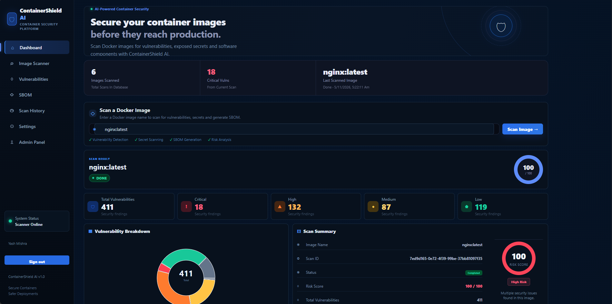
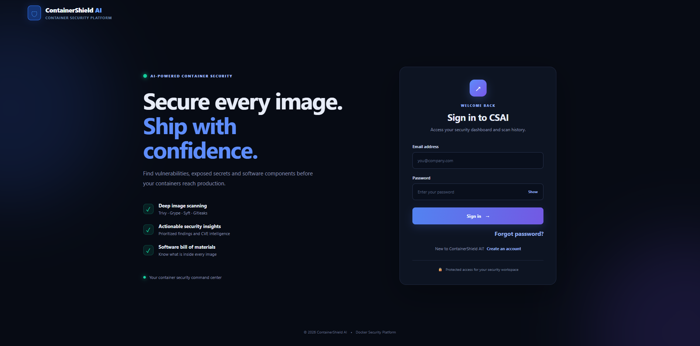

# 🛡️ ContainerShield AI (CSAI)

### Container Security & Vulnerability Scanning Platform

**ContainerShield AI** is a DevSecOps security platform designed to scan Docker images, identify vulnerabilities, detect exposed secrets, generate Software Bill of Materials (SBOM), and provide centralized container security insights.

It integrates multiple open-source security scanners into a unified dashboard, helping developers and DevOps engineers understand and improve container security.

<p align="center">
  <a href="https://csai.duckdns.org">
    
  </a>
  <a href="https://github.com/yashmishra045/Containershield-ai">
    
  </a>
</p>

---

## 🌐 Live Application

**Try ContainerShield AI:** https://csai.duckdns.org

> The live application is hosted on AWS EC2. Availability depends on the production server being online.

---

## 📸 Project Screenshots

### 1. ContainerShield AI – Dashboard




---

## 🚀 Key Features

- **Docker Image Scanning:** Scan Docker images for known security vulnerabilities.
- **Multi-Scanner Integration:** Integrates Trivy and Grype for vulnerability analysis.
- **SBOM Generation:** Generates Software Bill of Materials using Syft.
- **Secret Detection:** Detects potentially exposed credentials and secrets using Gitleaks.
- **Vulnerability Classification:** Categorizes findings into Critical, High, Medium, and Low severity levels.
- **Security Dashboard:** Displays vulnerability breakdowns and security insights.
- **Scan History:** Stores and tracks previous scan results.
- **Live Scan Progress:** Displays scan status and progress information.
- **Authentication:** Provides authenticated access to the application.
- **Admin Panel:** Provides administrative functionality and access management.
- **Security Reports:** Supports downloadable scan reports.
- **Database Integration:** Stores application and scan information in PostgreSQL.

---

## 🧰 Technology Stack

| Category | Technologies |
|---|---|
| Frontend | React.js, JavaScript, CSS |
| Backend | Python, FastAPI |
| Database | PostgreSQL |
| ORM | SQLAlchemy |
| Containerization | Docker |
| Container Orchestration | Docker Compose |
| Reverse Proxy | Nginx |
| Vulnerability Scanning | Trivy, Grype |
| SBOM Generation | Syft |
| Secret Detection | Gitleaks |
| Cloud Platform | AWS EC2 |
| CI/CD | GitHub Actions |
| Version Control | Git & GitHub |

---

## 🔍 Integrated Security Tools

### Trivy
Scans container images for operating system and application dependency vulnerabilities.

### Grype
Identifies known vulnerabilities in packages and container images.

### Syft
Generates Software Bill of Materials (SBOM), providing visibility into software packages and components.

### Gitleaks
Scans for exposed secrets, API keys, passwords, and credentials.

---

## 🏗️ System Architecture

```text
                  USER
                    |
                    v
             React Frontend
                    |
                    v
                NGINX
                    |
                    v
             FastAPI Backend
                    |
          +---------+---------+
          |         |         |
          v         v         v
        Trivy     Grype    Gitleaks
          |         |         |
          +---------+---------+
                    |
                    v
                   Syft
                    |
                    v
             Scan Result Processing
                    |
                    v
               PostgreSQL
                    |
                    v
             Security Dashboard
```

---

## ⚙️ Application Workflow

1. User accesses the ContainerShield AI dashboard.
2. User submits a Docker image name.
3. FastAPI receives the scanning request.
4. Backend executes the integrated security scanners.
5. Trivy and Grype identify vulnerabilities.
6. Syft generates the SBOM.
7. Gitleaks checks for exposed secrets.
8. Scan results are processed and stored in PostgreSQL.
9. Dashboard displays vulnerability statistics and scan results.
10. Users can review scan history and download reports.

---

## ☁️ Cloud Deployment

ContainerShield AI is deployed on an **AWS EC2 Ubuntu instance** using Docker Compose.

Deployment components:

- AWS EC2 – Cloud hosting infrastructure
- Ubuntu – Server operating system
- Docker – Application containerization
- Docker Compose – Multi-container management
- Nginx – Frontend hosting and reverse proxy
- FastAPI – Backend API service
- PostgreSQL – Persistent database

**Live URL:** https://csai.duckdns.org

---

## 🖥️ Run Locally

### Prerequisites

- Python 3.x
- Node.js and npm
- Docker
- Docker Compose
- Git

### 1. Clone Repository

```bash
git clone https://github.com/yashmishra045/Containershield-ai.git

cd Containershield-ai
```

### 2. Configure Environment Variables

Create the required `.env` file using the environment variables expected by the application.

Keep database credentials, JWT secrets, and other sensitive configuration out of Git.


## 🔐 Security Considerations

- Authenticated application access.
- Secure handling of environment variables.
- Container image vulnerability analysis.
- Secret detection through Gitleaks.
- SBOM generation for software component visibility.
- Role-based access management.

---

## 🔮 Future Enhancements

- AI-powered vulnerability explanations.
- Automated vulnerability remediation recommendations.
- GitHub repository security auditing.
- Advanced CI/CD security integration.
- Policy-based security enforcement.
- Scalable queue-based scanning.
- Advanced security analytics.
- Unified DevSecOps Security Suite integrating container and source-code security.

---

## 👨‍💻 Author

**Prashant Mishra**
**Aman Mishra**
**Yash Mishra**


B.Tech – Information Technology

- GitHub: https://github.com/yashmishra045
- Project: https://github.com/yashmishra045/Containershield-ai
- Live Application: https://csai.duckdns.org

---

## ⭐ Support

If you find ContainerShield AI useful, consider giving this repository a ⭐ on GitHub.

**ContainerShield AI – Making Container Security Smarter.**
