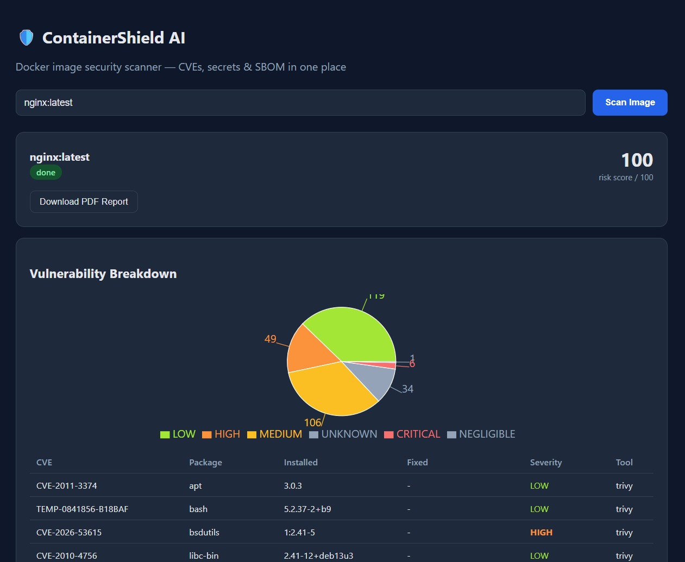

# 🛡️ ContainerShield AI

**An intelligent Docker image security scanner with vulnerability detection, secret scanning, SBOM generation, and AI-assisted remediation.**

ContainerShield AI scans any Docker image and gives you a single, unified view of its security posture — CVEs, exposed secrets, and a full software bill of materials — with a clean dashboard and downloadable PDF reports.

---

## ✨ Features

- 🔍 **Vulnerability scanning** — cross-checked using both **Trivy** and **Grype**, deduplicated into a single results list
- 🔑 **Secret detection** — scans the image filesystem for exposed credentials, API keys, and tokens using **Gitleaks**
- 📦 **SBOM generation** — full software bill of materials via **Syft**
- 📊 **Risk scoring** — weighted 0–100 score based on vulnerability severity
- 🖥️ **Live dashboard** — React-based UI with real-time scan status and severity breakdown charts
- 📄 **PDF reports** — one-click downloadable security reports
- 🤖 **Planned:** AI-based remediation suggestions, CIS Docker Benchmark checks, scan history & trends, CI/CD integration

---

## 🖥️ Dashboard Preview

<p align="center">
  <a href="https://drive.google.com/file/d/1lS4XkI1r2IPgIjD6iBFGmB9ss6Yo6UMz/view?usp=drivesdk">
    
  </a>
</p>

<p align="center">
  <sub>Scan results for <code>nginx:latest</code> — risk score, severity breakdown, and per-CVE detail. <a href="https://drive.google.com/file/d/1lS4XkI1r2IPgIjD6iBFGmB9ss6Yo6UMz/view?usp=drivesdk">View full size ↗</a></sub>
</p>

---

## 🔧 Security Tools Used

ContainerShield AI orchestrates four industry-standard, open-source security scanners under one roof, and combines their output into a single normalized report:

### 🩹 [Trivy](https://aquasecurity.github.io/trivy/) — Vulnerability Scanner
Developed by Aqua Security, Trivy scans container images layer-by-layer against known CVE databases to detect vulnerable OS packages and application dependencies. It's fast, widely adopted in production CI/CD pipelines, and covers a broad range of package managers (apt, yum, npm, pip, etc.).

### 🕵️ [Grype](https://github.com/anchore/grype) — Cross-Check Vulnerability Scanner
Built by Anchore, Grype is run alongside Trivy as a second, independent vulnerability scanner. Different tools use different vulnerability databases and matching logic, so running both and deduplicating results reduces false negatives and gives more confidence in the final CVE list.

### 🔑 [Gitleaks](https://github.com/gitleaks/gitleaks) — Secret Scanner
Gitleaks scans the image's exported filesystem for hardcoded secrets — API keys, access tokens, private keys, database credentials, and other sensitive strings accidentally baked into an image during build. Catching these before deployment prevents credential leaks in production.

### 📦 [Syft](https://github.com/anchore/syft) — SBOM Generator
Also from Anchore, Syft generates a Software Bill of Materials (SBOM) — a complete inventory of every package, library, and component inside the image, along with their versions. This is essential for supply-chain security and compliance (e.g. knowing exactly what's running before the next CVE drops).

**Why four tools instead of one?** Each tool has a different focus and different blind spots. Running them together and merging the results gives a far more complete security picture than any single scanner alone — which is the whole premise of ContainerShield AI.

---

## 🏗️ Tech Stack

| Layer | Technology |
|---|---|
| Backend | FastAPI (Python) |
| Frontend | React + Vite |
| Database | PostgreSQL |
| Reports | ReportLab (PDF) |
| Scanning Engines | Trivy, Grype, Gitleaks, Syft |
| Infrastructure | Docker & Docker Compose |

---

## 🚀 Quick Start

### Prerequisites
- Docker + Docker Compose
- Node.js 18+ (only needed for local frontend development)

The backend Docker image installs Trivy, Grype, Syft, and Gitleaks automatically — no need to install any scanner tools on your host.

### Run everything with Docker

```bash
git clone https://github.com/yashmishra045/Containershield-ai.git
cd Containershield-ai
docker compose up --build
```

This starts:
- **PostgreSQL** on `localhost:5432`
- **Backend (FastAPI)** on `http://localhost:8000`

> The backend container mounts your host's Docker socket (`/var/run/docker.sock`) so it can pull and inspect the images you scan.

### Run the frontend

```bash
cd frontend
npm install
npm run dev
```

Open `http://localhost:5173`, enter an image name (e.g. `nginx:latest`), and hit **Scan Image**.

---

## 🧩 Running the backend without Docker

1. Run Postgres locally, or just: `docker compose up db`
2. Install the scanner tools on your machine:
   - [Trivy](https://aquasecurity.github.io/trivy/latest/getting-started/installation/)
   - [Grype](https://github.com/anchore/grype#installation)
   - [Syft](https://github.com/anchore/syft#installation)
   - [Gitleaks](https://github.com/gitleaks/gitleaks#installing)
